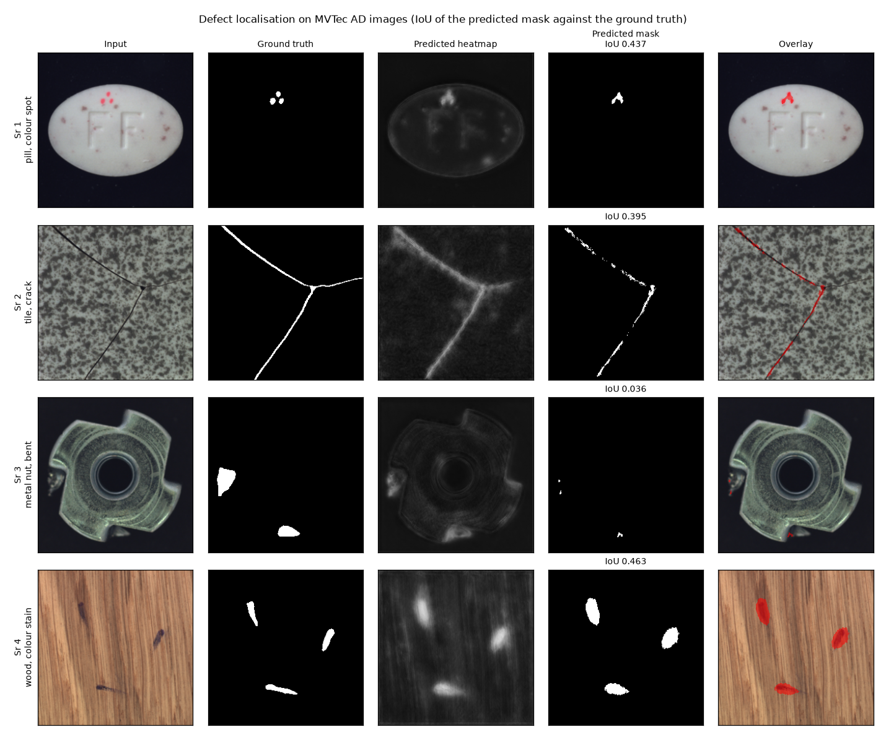
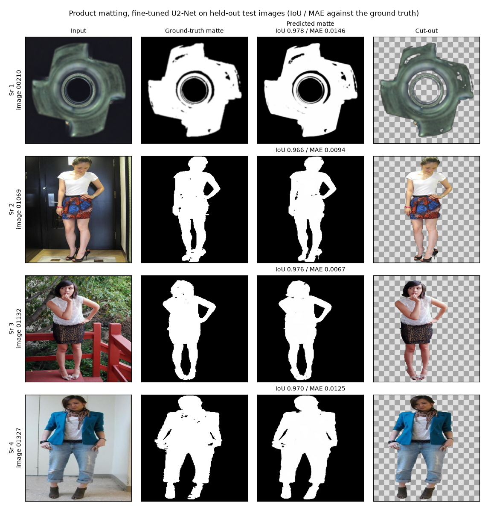
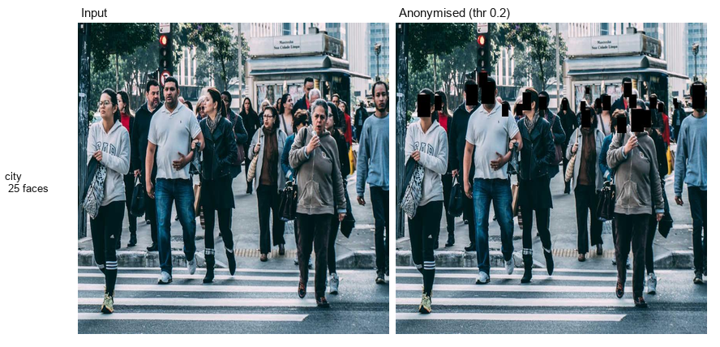

# Deep Computer Vision

We built eight deep-learning computer vision projects covering recognition and
understanding: defect localisation, matting, face anonymisation, human pose, video
action recognition, video instance segmentation and anomaly detection. Three train
or fine-tune a model and report train, validation and test; the others score
published weights on official held-out splits and report what the number does and
does not show. It is for practitioners who want measured numbers, with the code and
notebooks that produced them, rather than demo screenshots.

3-D work (depth, point clouds, novel views, volumetric segmentation) lives in
[3d-computer-vision](https://github.com/hammasbuilds/3d-computer-vision).

## Projects

| Project | What | Test result |
|---|---|---|
| [defect-localisation](defect-localisation/) | Pixel-level defect localisation on MVTec AD, DRAEM-style U-Net trained from scratch | pixel AP 0.9583 |
| [product-matting](product-matting/) | Alpha mattes for background removal, U2-Net fine-tuned | IoU 0.9611 / MAE 0.0104 |
| [gdpr-anonymisation](gdpr-anonymisation/) | Detect and black out every face in a crowd (CenterFace, no training) | 25 faces on the sample street photo |
| [industrial-anomaly](industrial-anomaly/) | MVTec AD anomaly detection with frozen ResNet-50 patch features, nothing trained | mean image AUROC 0.9379 |
| [pose-estimation](pose-estimation/) | 2D human keypoints, Keypoint R-CNN on COCO val2017 | OKS AP 0.656, PCK@0.2 0.95364 |
| [video-action-recognition](video-action-recognition/) | UCF101 split 1, linear probe on frozen Kinetics-400 r3d_18 features | top-1 0.80941, top-5 0.96405 |
| [video-instance-segmentation](video-instance-segmentation/) | Mask R-CNN frame by frame on DAVIS 2017 val | matched IoU 0.76111 at coverage 0.80328 |
| [anomaly-detection](anomaly-detection/) | UCF-Crime weakly-supervised multiple-instance learning | frame-level AUC 0.76329 |

## What it does

- Trains and fine-tunes on a fixed 80/15/5 split and reports all three splits
  (defect-localisation, product-matting).
- Scores published weights on official held-out splits (COCO val2017, UCF101
  split 1, DAVIS 2017 val, UCF-Crime test) with leakage checks between splits.
- Adds a control to each measurement where one exists: raw pixels against
  learned features, the published pose score against the measured one, a naive
  whole-video label against multiple-instance learning.
- Keeps every quoted number in the project's `results.json`.

## Sample input / output

**Defect localisation** - input, ground-truth defect mask, the model's heatmap, its
thresholded mask (IoU against the ground truth) and the overlay, on four MVTec AD
parts:



**Product matting** - held-out test images: the fine-tuned U2-Net's matte (IoU and
MAE against the ground truth) and the cut-out over a checkerboard:



**Face anonymisation** - CenterFace at detection threshold 0.2 on a crowded street:



The two figures above are built from the committed `samples/` folders by
`python docs/make_figures.py`; the per-image scores are computed from those files.

## Results

- **Defect localisation:** pixel AP 0.9839 train / 0.9565 val / 0.9583 test,
  against 0.155 at epoch 0. Test pooled IoU 0.8033, per-image IoU 0.6232.
- **Product matting:** IoU 0.9903 train / 0.9625 val / 0.9611 test, MAE 0.0104 on
  test.
- **Industrial anomaly, no training:** frozen ResNet-50 features 0.9379 mean image
  AUROC against 0.6700 for raw pixels in the same pipeline; the features are worth
  +0.3292 AUROC on objects and +0.1455 on textures.
- **Pose:** OKS AP 0.656 against the published 65.0 for these weights; at PCK@0.05
  the worst joint is the hip, not the wrist.
- **Action recognition:** test top-1 0.80941; the leading confusions are pairs that
  share a scene (FrontCrawl vs BreastStroke, PlayingDhol vs PlayingTabla).
- **Video instance segmentation:** masks are as steady as the ground truth
  (frame-to-frame IoU 0.78932 vs 0.78441), but the identity jump rate is
  0.10342: the problem is association, not segmentation.
- **Surveillance anomaly:** AUC 0.76329, yet catching 80% of anomalous frames flags
  43.754% of all frames.

## Tech stack

- Python, PyTorch, torchvision (Keypoint R-CNN, Mask R-CNN, r3d_18, ResNet-50)
- U2-Net and a DRAEM-style U-Net (`DiscriminativeSubNetwork`) for the trained projects
- CenterFace via `deface` and ONNX Runtime for anonymisation
- scikit-learn, SciPy, NumPy, Pillow, pycocotools
- matplotlib for figures
- Kaggle notebooks (GPU) for the measured projects

## Run it

The five measurement projects are notebooks that run as-is on Kaggle; each
project README links its Kaggle notebook:

- [pose-estimation](https://www.kaggle.com/code/muhammadhammas13/pose-pck-and-oks-per-joint)
- [video-action-recognition](https://www.kaggle.com/code/muhammadhammas13/ucf101-top1-top5-and-confusion-pairs)
- [video-instance-segmentation](https://www.kaggle.com/code/muhammadhammas13/davis-mask-ap-and-temporal-consistency)
- [anomaly-detection](https://www.kaggle.com/code/muhammadhammas13/ucf-crime-frame-level-auc)
- [industrial-anomaly](https://www.kaggle.com/code/muhammadhammas13/mvtec-anomaly-without-training)

Rebuild the comparison figures from the committed samples (CPU, seconds):

```bash
pip install numpy pillow matplotlib
python docs/make_figures.py
```

The training scripts (`defect-localisation/train_localization.py`,
`product-matting/train_matting.py`) need a CUDA GPU, the dataset, and the upstream
model code (anomalydiffusion's `unet_utils`, U-2-Net) cloned next to the script;
the exact settings are in each project's `PARAMS.md`. Trained weights are not
included because the checkpoints are 109-294 MB, over GitHub's 100 MB file limit.

## Licence

No licence file is included, so the code is all rights reserved. Data: MVTec AD (CC BY-NC-SA 4.0), COCO val2017
(CC BY 4.0 annotations), UCF101, DAVIS 2017, UCF-Crime, LIP/ATR and WIDER FACE
belong to their authors and are used for research measurement only.
